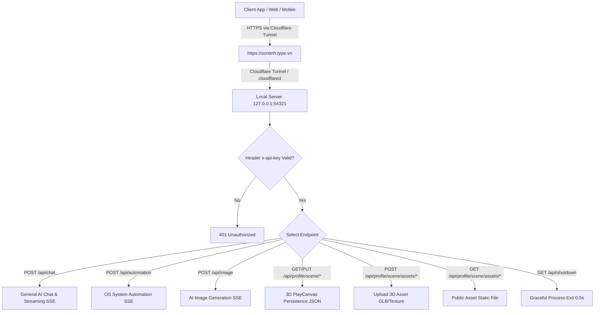

# Cẩm nang Quy tắc Kỹ thuật & Vận hành ai_agent_linux (Mandatory System Rules)

> **Tài liệu Tham chiếu Tối cao & Đầy đủ Nhất** dựa trên mã nguồn thực tế [`ai_agent.py`](file:///home/yenai/Documents/Projects/Typing/apps/agent/ai_agent.py).
> Tất cả các AI Agent, module tích hợp, và lập trình viên khi làm việc với `ai_agent_linux` (Mì Tôm AI / Sơn Tinh Agent) **BẮT BUỘC** phải tuân thủ 100% các quy tắc kỹ thuật dưới đây.

---

## 1. Tổng quan Kiến trúc Hệ thống & Cloudflare Tunnel

- **Tên dịch vụ:** Mì Tôm AI - Multimodal Standalone Agent (`v2.0`).
- **Nền tảng công nghệ:** Python 3, FastAPI, Uvicorn, Asyncio, WebSockets Relay, Edge-TTS / gTTS, PyInstaller.
- **Cổng dịch vụ cục bộ (Local Port):** `http://127.0.0.1:54321`
- **🌐 Giao thức Cloudflare Tunnel & Endpoint Chính thức:**
  - Toàn bộ chương trình `ai_agent_linux` chạy cục bộ tại cổng `54321` được **Tunnel công khai bảo mật thông qua Cloudflare Tunnel (`cloudflared`)** tới tên miền chính thức: **`https://sontinh.type.vn`**.
  - **Tất cả kết nối từ Client App, Web Frontend, và Mobile App** BẮT BUỘC phải trỏ tới Endpoint HTTPS công khai **`https://sontinh.type.vn`** thay vì gọi trực tiếp Localhost, đảm bảo đường truyền được mã hóa SSL/TLS an toàn và đi qua hạ tầng Cloudflare.
- **Chức năng cốt lõi:**
  1. **HTTP REST & SSE Streaming API:** Cung cấp giao diện tương tác AI chat đa phương tiện, phát âm thanh tổng hợp (TTS) theo thời gian thực.
  2. **Computer OS Automation:** Thực thi tác vụ điều khiển desktop và hệ điều hành Linux thông qua công cụ CLI (`agy` và `claude`).
  3. **Multimodal Reference File Reader:** Tự động trích xuất và đọc hiểu đa dạng định dạng tệp tham chiếu (văn bản, mã nguồn, PDF, Word, Ảnh, Audio/Video, tệp nhị phân).
  4. **3D PlayCanvas Profile Persistence Manager:** Quản lý, đồng bộ và cập nhật trực tiếp dữ liệu không gian 3D, nhân vật, đồ vật (Props), kịch bản sự kiện (Events) và hành động (Animations) tại `~/Documents/ai.type/data/profiles/`.
  5. **WebSocket Relay Client/Server:** Hỗ trợ điều khiển từ xa thông qua WebSocket Relay giữa máy trạm Linux và thiết bị di động.

---

## 2. Quy tắc Khởi chạy, Tham số CLI & Biến Môi trường

### 2.1. Tham số Dòng lệnh (CLI Arguments) & Xác thực API Key
- **`--api-key`**: Khóa xác thực API.
  - Nếu truyền qua dòng lệnh: `--api-key <KEY>` (Lưu ý: Khuyên dùng biến môi trường để tránh lộ secret trong `ps` / `/proc/<pid>/cmdline`).
  - Mặc định đọc từ biến môi trường **`AI_AGENT_API_KEY`** (Nếu không truyền, mặc định là `"type-vn-local-agent-2026"`).
  - **Cấu trúc Relay:** Nếu khóa chứa ký tự `|` và bắt đầu bằng `ws` (ví dụ: `wss://sontinh.type.vn/ws/relay|secret_123`), hệ thống sẽ tách thành 2 tham số: `RELAY_TO` (`wss://sontinh.type.vn/ws/relay`) và `SECRET_AGENT_KEY` (`secret_123`). Agent sẽ tự động kích hoạt chế độ **WebSocket Relay Client** kết nối ra máy chủ trung gian.

### 2.2. Cấu hình Xác thực cho Claude Code CLI
Để gọi các model Anthropic Claude (`claude-3-5-sonnet`, `opus`, `haiku`,...), hệ thống ưu tiên kiểm tra xác thực theo 3 thứ tự:
1. **Gateways / Proxy (Ưu tiên 1):** `ANTHROPIC_AUTH_TOKEN` và `ANTHROPIC_BASE_URL` (truyền qua env hoặc `--anthropic-auth-token`, `--anthropic-base-url`).
2. **Anthropic Official API Key (Ưu tiên 2):** `ANTHROPIC_API_KEY` (truyền qua env hoặc `--anthropic-api-key`).
3. **OAuth Keyring Session (Ưu tiên 3):** Đã đăng nhập sẵn qua lệnh `claude /login` trên hệ thống.

### 2.3. Biến Môi trường Bắt buộc cho Subprocess CLI
Khi `ai_agent.py` kích hoạt tiến trình con (`agy` hoặc `claude`), các biến môi trường sau **BẮT BUỘC** phải được nạp vào tiến trình con để đảm bảo khả năng tương tác với giao diện Linux (X11 / Wayland / DBus):
- `PYTHONUNBUFFERED=1`
- `DISPLAY=:0` (Hoặc lấy từ môi trường hiện tại)
- `XAUTHORITY=~/.Xauthority`
- `DBUS_SESSION_BUS_ADDRESS=unix:path=/run/user/1000/bus`
- `XDG_RUNTIME_DIR=/run/user/1000`
- `PATH`: Tự động bổ sung các thư mục chứa binary phổ biến: `~/.local/bin`, `/usr/local/bin`, `/opt/homebrew/bin`.

---

## 3. Quy tắc Thực thi Lệnh Hệ điều hành & Tự động hóa Linux Desktop

### 3.1. Quy tắc Mở Ứng dụng Đồ họa (GUI) & Trình duyệt Web
Khi Agent thực hiện tác vụ mở ứng dụng GUI (như trình duyệt web) từ tiến trình chạy ngầm, 2 sự cố hệ thống chí mạng thường xảy ra:
1. **Lỗi SIGHUP (Chết yểu tiến trình):** Lệnh thực thi qua PTY ảo sẽ bị giết ngay khi lệnh CLI kết thúc, cho dù dùng `&`, `nohup` hay `setsid`.
2. **Lỗi Snap / AppArmor (Tàng hình cửa sổ):** Dùng `xdg-open` vô tình kích hoạt trình duyệt mặc định dạng Snap (như Firefox Snap), Snap bị chặn vẽ giao diện lên Wayland khiến tiến trình chạy ngầm ăn CPU nhưng không hiện cửa sổ.

> [!CRITICAL]
> **QUY TẮC BẮT BUỘC KHI MỞ GUI/WEBSITE ON LINUX:**
> - **TUYỆT ĐỐI KHÔNG** sử dụng `xdg-open`, `&`, `nohup`, hoặc `setsid`.
> - **BẮT BUỘC** dùng `systemd-run --user` để chuyển giao quyền quản lý tiến trình cho Systemd Daemon của user.
> - **BẮT BUỘC** truyền đầy đủ các biến môi trường Wayland/X11 vào tham số `--setenv`.
> - **SỬ DỤNG TRÌNH DUYỆT NATIVE:** Sử dụng trực tiếp `/usr/bin/opera-gx` (Bản native không bị cách ly Snap).
>
> **Cú pháp chuẩn duy nhất:**
> ```bash
> systemd-run --user --setenv=DBUS_SESSION_BUS_ADDRESS=unix:path=/run/user/1000/bus --setenv=DISPLAY=:0 --setenv=WAYLAND_DISPLAY=wayland-0 --setenv=XDG_RUNTIME_DIR=/run/user/1000 /usr/bin/opera-gx "<URL_HOẶC_TRANG_WEB>"
> ```

### 3.2. Quy tắc Tìm & Mở Video / Nhạc trên YouTube
- **TUYỆT ĐỐI KHÔNG** mở trang tìm kiếm dạng `https://www.youtube.com/results?search_query=...` bắt người dùng tự click.
- **BẮT BUỘC TRUY VẤN VIDEO ID TRƯỚC:** Sử dụng công cụ `yt-dlp` để lấy Video ID chính xác:
  ```bash
  yt-dlp "ytsearch1:<tên_bài_hát_hoặc_video>" --get-id
  ```
- **TẠO URL TRỰC TIẾP:** Ghép Video ID thu được thành URL `https://www.youtube.com/watch?v=<VIDEO_ID>` rồi mới gọi lệnh `systemd-run` + Opera GX để khởi chạy.

### 3.3. Quy tắc Tương tác Web Automation (Upload Ảnh / Video)
- **TUYỆT ĐỐI KHÔNG** sử dụng automation (Playwright/Puppeteer) để click vào các nút chọn tệp ("Upload button", "Ảnh/video") làm nảy ra hộp thoại hệ thống **File Picker Dialog**. Việc này làm kẹt tiến trình vĩnh viễn do AI không thể tương tác với hộp thoại OS Native.
- **CÁCH XỬ LÝ BẮT BUỘC:** Tìm phần tử `<input type="file" ...>` bị ẩn bên dưới DOM và truyền trực tiếp đường dẫn tuyệt đối của tệp vào phần tử đó qua mã script automation (ví dụ: `elementHandle.setInputFiles(...)`).

### 3.4. Ràng buộc Thực thi Hành động (`run_command`)
- Khi người dùng yêu cầu một hành động thực tế trên máy tính, Agent **KHÔNG ĐƯỢC CHỈ VIẾT MÃ BASH BẰNG MARKDOWN** và nói rằng đã hoàn thành.
- Agent **BẮT BUỘC** phải kích hoạt Tool `run_command` để terminal/bash thực thi thực tế trên máy tính. Lời phản hồi chỉ được coi là hoàn tất khi Tool trả về kết quả thành công.

---

## 4. Định tuyến Endpoint API, Cloudflare Tunnel & Phân định Chức năng

### 4.1. Quy tắc Định tuyến Cloudflare Tunnel (`https://sontinh.type.vn`)
- **Tuyệt đối KHÔNG hardcode** hoặc gọi trực tiếp đến `http://127.0.0.1:54321` trên Frontend/Client.
- Mọi yêu cầu kết nối API từ ứng dụng người dùng BẮT BUỘC phải trỏ qua tên miền chính thức tunneled qua Cloudflare: **`https://sontinh.type.vn`**.
- Tất cả Yêu cầu HTTP (ngoại trừ Public Assets) **BẮT BUỘC** phải truyền Header:
  `x-api-key: <SECRET_AGENT_KEY>`



### 4.2. Phân định Chức năng Chi tiết giữa các Endpoint

#### 💬 Endpoint `/api/chat` (General Multimodal Chat)
- **Endpoint URL:** `https://sontinh.type.vn/api/chat`
- **Mục đích:** Xử lý hội thoại thông thường, trả lời câu hỏi, giải toán, tóm tắt tệp, phát âm thanh đọc bài (TTS).
- **Giao thức:** SSE (`text/event-stream`).
- **Quy tắc Phân loại Prompt:** Nếu người dùng chỉ hỏi thông tin bình thường (thời tiết, kiến thức, lịch âm,...), Agent phải trả lời ngắn gọn bằng văn bản và **KHÔNG THỰC THI BẤT KỲ LỆNH HỆ THỐNG NÀO**.

#### 🖥️ Endpoint `/api/automation` & `/api/automate` (Computer OS Automation)
- **Endpoint URL:** `https://sontinh.type.vn/api/automation`
- **Mục đích:** Chuyên biệt cho tác vụ tự động hóa và điều khiển máy tính.
- **Tự động nạp Prompt Hệ thống:** Thiết lập `is_automation=True`, bổ sung các chỉ thị bắt buộc về `systemd-run`, Opera GX, `yt-dlp`, và `ImageName` UUID.

#### 🖼️ Endpoint `/api/image` & `/api/generate-image` (AI Image Generation)
- **Endpoint URL:** `https://sontinh.type.vn/api/image`
- **Mục đích:** Chuyên biệt cho việc tạo và sinh hình ảnh nghệ thuật AI chất lượng cao (HD, 2K, 4K).
- **Hỗ trợ tùy chọn:** Tự động nhận diện các tham số `aspect_ratio`, `quality`, `style`, `prompt`/`description` và tự động upscale kích thước ảnh tối thiểu 2K HD.

#### 🎨 Endpoint `/api/profile/scene/{username}` & Assets (3D Data Persistence)
- **Endpoint URL:** `https://sontinh.type.vn/api/profile/scene/{username}`
- **Vị trí lưu trữ dữ liệu:** `~/Documents/ai.type/data/profiles/{username}/`
- **Các tệp quản lý:** `profile.json`, `character.json`, `room.json`, `animations.json`, `events.json`, `props.json`.
- **Định tuyến Sub-endpoints:**
  - `GET /api/profile/scene/{username}`: Đọc dữ liệu profile và trả về danh sách `_assets`. (Tự khởi tạo dữ liệu mặc định nếu là user mới).
  - `PUT /api/profile/scene/{username}`: Đồng bộ và cập nhật dữ liệu 3D.
  - `POST /api/profile/scene/assets/{username}/{filename}`: Upload asset 3D (chỉ chấp nhận `.glb`, `.gltf`, `.png`, `.jpg`, `.jpeg`, `.webp`, `.json`).
  - `GET /api/profile/scene/assets/{username}/{filename}`: Endpoint **Public Access** (không yêu cầu Auth) để engine 3D PlayCanvas tải trực tiếp file GLB / Texture qua Cloudflare Tunnel.

> [!IMPORTANT]
> **NGUYÊN TẮC VÀNG VỀ BIỆT LẬP 3D SCENE API:**
> Nhóm API `/api/profile/scene/` **CHỈ XỬ LÝ DUY NHẤT** việc đọc/ghi dữ liệu 3D tại thư mục `Documents/ai.type/data/profiles/`.
> **TUYỆT ĐỐI KHÔNG** gọi các LLM (Gemini/Claude), KHÔNG phát stream SSE, KHÔNG tạo giọng nói TTS, và KHÔNG chứa bất kỳ side-effect thực thi lệnh hệ thống (`run_command`) nào.

---

## 5. Quy tắc Đọc & Trích xuất Nội dung Tệp Tham chiếu (Reference Files)

Agent hỗ trợ nạp tệp tham chiếu tự động qua 3 nguồn:
1. **Chuỗi Base64 (`files_data`):** Giải mã và lưu tạm vào `temp_uploads/`.
2. **Mảng đường dẫn (`file_paths`, `reference_files`, `files`):** Truyền đường dẫn tuyệt đối trực tiếp.
3. **Tự động trích xuất từ Prompt Text:** Regex phát hiện các đường dẫn dạng `/path/to/file` hoặc `C:\...` có sẵn trên đĩa.

### 5.1. Cơ chế Trích xuất theo Định dạng (`extract_file_content_and_info`)
- **Văn bản & Mã nguồn (`.txt`, `.md`, `.py`, `.js`, `.json`, `.html`, `.css`,...):** Đọc trực tiếp utf-8, cắt bớt nếu vượt quá **100,000 ký tự**.
- **Tệp PDF (`.pdf`):** Thử trích xuất văn bản lần lượt theo thứ tự ưu tiên: `pypdf` ➔ `PyPDF2` ➔ `fitz` (PyMuPDF) ➔ Lệnh hệ thống `pdftotext`. Cắt bớt nếu vượt quá **100,000 ký tự**.
- **Tệp Word (`.docx`, `.doc`):** Thử trích xuất qua `python-docx` ➔ `docx2txt` ➔ Giải nén Zip đọc `word/document.xml`. Cắt bớt nếu vượt quá **100,000 ký tự**.
- **Tệp Hình ảnh (`.png`, `.jpg`, `.webp`,...):** Trích xuất độ phân giải (`width x height`) và format. Đẩy đường dẫn tuyệt đối cho Agent gọi công cụ phân tích thị giác.
- **Tệp Media (`.mp4`, `.mp3`, `.mkv`,...):** Thử gọi `ffprobe` lấy thời lượng (`duration`). Đẩy đường dẫn tuyệt đối cho Agent xử lý.
- **Tự động dọn dẹp:** Tất cả tệp tạm giải mã từ Base64 trong `temp_uploads/` sẽ tự động bị xóa bỏ sau khi hoàn tất request.

---

## 6. Quy tắc Xử lý LLM CLI Backend (`agy` vs `claude`)

Hệ thống tự động chọn CLI Engine dựa trên tên `model` truyền vào request:

| Tiêu chí | Engine `claude` (Anthropic Claude CLI) | Engine `agy` (Antigravity CLI) |
| :--- | :--- | :--- |
| **Điều kiện nhận diện Model** | Tên model chứa từ khóa: `claude`, `opus`, `sonnet`, `haiku`, `fable` | Tất cả các model còn lại (Gemini, Llama,...) |
| **Cú pháp lệnh CLI** | `claude --print <prompt> --dangerously-skip-permissions --model <model>` | `agy --print <prompt> --dangerously-skip-permissions [--model <model>]` |
| **Tham số Effort** | Tự động quản lý theo Claude CLI | Nếu model chứa từ `flash`, tự động gắn `--effort high` |
| **Quản lý Hội thoại** | Dùng `--resume <session_id>` hoặc `--session-id <session_id>` | Dùng `--conversation <conversation_id>` |

### 6.1. Quy tắc Chống hỏng Session Claude CLI (`claude_session_exists`)
- **Vấn đề:** Tiến trình `ai_agent.py` có thể bị Electron hoặc hệ thống restart bất ngờ. Nếu dùng biến RAM để ghi nhớ session đã khởi tạo, khi restart biến RAM bị xóa khiến lệnh gọi lại `--session-id <ID>` gây ra lỗi fatal: `"Session ID ... is already in use"`.
- **CÁCH XỬ LÝ CHUẨN KỸ THUẬT:**
  - Định danh `session_id` cố định bằng UUIDv5: `uuid.uuid5(uuid.NAMESPACE_URL, conversation_id)`.
  - Kiểm tra trực tiếp trên đĩa thông qua pattern: `~/.claude/projects/**/<session_id>.jsonl`.
  - Nếu tệp `.jsonl` đã tồn tại trên đĩa: Bắt buộc gọi `--resume <session_id>`.
  - Nếu chưa tồn tại: Mới được gọi `--session-id <session_id>`.

---

## 7. Quy tắc Sinh Ảnh, Video & Xử lý Media (Image & Video Generation)

### 7.1. Tham số `ImageName` BẮT BUỘC
- Khi Agent gọi Tool tạo ảnh (`generate_image`), tham số `ImageName` **BẮT BUỘC** phải truyền đúng chuỗi UUID được định nghĩa ở cuối prompt: `agimg<12_ký_tự_hex>` (ví dụ: `agimg8f3a9b1c2d4e`).
- **CẤM** tự ý đổi tên `ImageName` thành tên ngẫu nhiên vì sẽ làm hỏng dữ liệu liên kết ảnh trên giao diện ứng dụng.

### 7.2. Tự động Upscale Ảnh Nâng cao (LANCZOS)
- Nếu prompt người dùng chứa cụm từ `"kích thước là 4k"`, hệ thống tự động upscale chiều rộng ảnh lên **3840px**.
- Nếu prompt chứa cụm từ `"kích thước là 2k"`, hệ thống tự động upscale chiều rộng ảnh lên **2560px**.
- Thuật toán upscale: Giữ nguyên tỉ lệ khung hình (Aspect Ratio) sử dụng `PIL.Image.Resampling.LANCZOS`.

### 7.3. Tìm kiếm Fallback & Trả về Media
- Nếu tệp ảnh/video không xuất hiện tại thư mục đích, Agent tự động quét thư mục lưu trữ Antigravity Brain: `~/.gemini/antigravity-cli/brain/**/*<image_uid>*`.
- Mã hóa tệp thành chuỗi Base64 Data URI và tự động chèn mã Markdown hiển thị vào cuối luồng SSE:
  - **Hình ảnh:** ``
  - **Video:** `<video src="data:video/mp4;base64,..." controls></video>`

---

## 8. Quy tắc Tổng hợp Giọng nói Real-Time (TTS Voice Streaming)

- **Ngắt câu thông minh:** Đọc dữ liệu stdout từ CLI theo thời gian thực. Tích lũy các ký tự ngắt câu (`.`, `!`, `?`, `\n`). Khi câu đạt độ dài `> 10` ký tự, đẩy ngay vào hàng chờ tạo âm thanh (`audio_task_queue`).
- **Bộ lọc loại bỏ rác Markdown:** Tự động xóa tất cả khối mã code (```...```), ký tự `*`, `#` trước khi đọc để tránh phát âm rác ký tự.
- **Engine TTS:**
  - Nếu `tts_voice == 'google'`: Sử dụng `gTTS` (ngôn ngữ `vi`).
  - Nếu `tts_voice` khác 'none': Sử dụng `edge_tts.Communicate` với giọng đọc cấu hình (mặc định: `vi-VN-HoaiMyNeural`) và tốc độ đọc (`tts_rate`, mặc định `+0%`).
- **Đóng gói SSE:** File MP3 tạo ra được chuyển thành Base64 và phát sự kiện `data: {"audio_base64": "..."}` song song với luồng văn bản.

---

## 9. Quản lý & Cập nhật Dữ liệu 3D PlayCanvas (`update_playcanvas_3d_profile`)

### 9.1. Nạp Tự động Ngữ cảnh 3D (`load_all_user_3d_profiles_summary`)
Mỗi khi chạy tác vụ, hệ thống quét toàn bộ thư mục `~/Documents/ai.type/data/profiles/`. Tự động đọc và nạp cấu hình JSON (`character.json`, `room.json`, `profile.json`, `animations.json`, `events.json`, `props.json`) vào System Prompt để Agent nắm bắt 100% bối cảnh 3D hiện tại của người dùng.

### 9.2. Cấu trúc Cập nhật Patch Dữ liệu 3D
Hàm `update_playcanvas_3d_profile(username, patch)` xử lý cập nhật dữ liệu 3D theo cấu trúc JSON patch:

```json
{
  "character": { "animationState": "Dance", "skin": "cyberpunk" },
  "scene": { "lightsOn": false, "cameraPreset": "OVERHEAD" },
  "new_animation": { "name": "Múa quạt", "glbPath": "/assets/fan_dance.glb", "isMovement": false },
  "new_event": { "trigger": "clickTV", "actions": ["playVideo"] },
  "disable_trigger": "clickLightSwitch",
  "enable_trigger": "clickTV",
  "new_prop": { "id": "prop_desk_lamp", "name": "Đèn bàn học", "position": {"x": 2, "y": 5, "z": -10} },
  "delete_prop_id": "prop_old_chair",
  "modify_prop": { "targetPropId": "prop_main_desk", "patch": { "visible": false } }
}
```

- **Khởi tạo mặc định:** Nếu `props.json` chưa tồn tại, hệ thống tự động khởi tạo danh sách 23 đồ vật 3D mặc định (`DEFAULT_PROPS` bao gồm bàn Haigo, ghế ergonomic, màn hình ultrawide, PS5 Pro, công tắc dạ quang, bể cá thủy sinh,...).

---

## 10. WebSocket Relay Client / Server Protocol

- **Relay Server Mode:** Lắng nghe tại endpoint `/ws/relay`. Quản lý mảng `connected_pcs` và bản đồ công việc `active_tasks`.
- **Relay Client Mode:** Khởi chạy tự động trong hàm `startup_event()` nếu `RELAY_TO` được cấu hình (qua `wss://sontinh.type.vn/ws/relay`):
  - Kết nối tới `wss://sontinh.type.vn/ws/relay?api_key=<SECRET_AGENT_KEY>`.
  - Nhận yêu cầu xử lý từ thiết bị di động (Mobile App).
  - Thực thi `run_agent_task_logic` cục bộ trên máy trạm Linux.
  - Stream từng chunk kết quả và trạng thái hoàn tất (`done: true`) ngược trở lại Relay Server.
